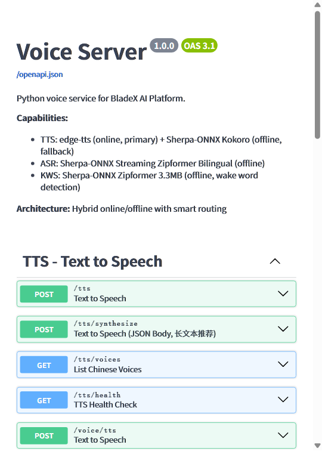

# 🎙️ xh-voice-server

> 一套开箱即用的 **语音服务中间件**：TTS（文本转语音）＋ ASR（语音转文本）＋ KWS（唤醒词检测），在线离线混合、智能降级、零密钥零成本。

[English](README.en.md) · [Changelog](CHANGELOG.md)

---

## 🖼 界面预览

> FastAPI 自带 Swagger UI 交互式 API 文档，浏览器打开即用：

```
http://localhost:8090/docs
```



---

## ✨ 特色与亮点

- **三合一语音能力**：一个服务同时提供 **TTS / ASR / KWS**，Web 前端与后端通过 HTTP + WebSocket 即可接入，无需额外依赖。
- **在线离线混合、智能降级**：TTS 优先走 `edge-tts`（微软 Azure Neural TTS，**免费、无需 API Key**），网络故障或超时 10s 自动降级到本地 Sherpa-ONNX Kokoro，**保证服务永不断流**。
- **全离线可用的 ASR / KWS**：语音识别与唤醒词检测全部本地推理，**敏感音频不出服务器**，支持中英双语流式识别。
- **零成本启动**：ASR/KWS 仅需下载开源模型（KWS 仅 3.3MB、ASR ~350MB）；TTS 在线引擎免下载免密钥，**配好即用**。
- **自定义唤醒词，无需重训**：编辑 `config.yaml` 的 `keywords` 字段即可定义任意唤醒词（拼音 token 格式），模型无需重新训练。
- **实时流式能力**：WebSocket 支持**边说话边识别**（ASR）与**边说话边监听**（KWS），适合语音助手/对话机器人/智能家居场景。
- **健康检查完备**：总健康 + 各引擎独立健康接口，方便接入监控告警。
- **跨平台部署**：Windows（`.bat` 一键启动）＋ Linux（systemd 单元 / `.sh`），原生 venv 即可运行，无需 Docker。
- **模型按需下载**：`scripts/download_models.py` 支持分模块下载，缺哪个下哪个，不占用仓库空间。

---

## 📦 功能特性

| 能力 | 引擎 | 在线/离线 | 说明 |
|---|---|---|---|
| **TTS 文本转语音** | edge-tts | 在线 | 微软 Azure Neural TTS，免费，8 个中文/方言音色 |
| **TTS 离线降级** | Sherpa-ONNX Kokoro | 离线 | 超时/断网自动切换，本地 CPU 推理 |
| **ASR 语音转文本** | Sherpa-ONNX Streaming Zipformer | 离线 | 中英双语，文件上传 + WebSocket 实时流 |
| **KWS 唤醒词** | Sherpa-ONNX Zipformer 3.3M | 离线 | 仅 3.3MB，自定义关键词（txt 配置，无需重训） |
| **VAD 语音活动检测** | Silero VAD | 离线 | ASR 降噪/切分，可选启用 |
| **实时流式 ASR** | WebSocket | — | `WS /asr/stream`，边说话边出字 |
| **实时流式 KWS** | WebSocket | — | `WS /kws/stream`，边说话边监听唤醒词 |
| **语音合成调节** | edge-tts | — | 语速 / 音调 / 音量 / 声音自由调节 |

---

## 🏗 架构

```
                       ┌───────────────────────────────────────────┐
     AI 前端 (Vue) ──▶ │            xh-voice-server (Python)        │
                       │               localhost:8090               │
                       │                                           │
     AI 后端 (Java) ──▶│  TTS: edge-tts (在线, 免费 Azure Neural)   │
                       │        │  超时10s/断网 自动降级              │
                       │        ▼                                  │
                       │        Sherpa-ONNX Kokoro (离线)          │
                       │                                           │
                       │  ASR:  Sherpa-ONNX Streaming Zipformer   │
                       │        (离线, 中英双语流式)                 │
                       │                                           │
                       │  KWS:  Sherpa-ONNX Zipformer 3.3M        │
                       │        (离线, 自定义唤醒词, 无需重训)        │
                       └──────────────┬────────────────────────────┘
                                      │
                       ┌──────────────▼──────────────┐
                       │  WebSocket: /asr/stream      │
                       │            /kws/stream       │
                       │  HTTP:     /tts /asr /kws    │
                       └─────────────────────────────┘
```

**模块结构**

- `app/main.py` — FastAPI 入口：路由注册、CORS、生命周期、模型预加载
- `app/config.py` — 配置加载（YAML → Pydantic Settings）
- `app/routers/` — `tts.py` / `asr.py` / `kws.py` API 路由
- `app/services/` — 业务服务：TTS / ASR / KWS + 模型管理器
- `app/utils/logger.py` — loguru 结构化日志
- `scripts/download_models.py` — 模型按需下载脚本
- `deploy/` — systemd 单元 + Linux 部署说明

---

## 🚀 快速开始

### 方式一：Windows 一键启动

```bat
:: 1. 创建虚拟环境
cd xh-voice-server
python -m venv .venv
.venv\Scripts\activate

:: 2. 安装依赖
pip install -r requirements.txt

:: 3. 下载需要的模型（KWS 秒下，ASR ~350MB，TTS 离线 ~180MB）
python scripts/download_models.py --check        :: 查看模型状态
python scripts/download_models.py --kws          :: 下载 KWS（3.3MB）
python scripts/download_models.py --asr          :: 下载 ASR（~350MB）
python scripts/download_models.py --tts          :: 下载 TTS 离线降级（~180MB）

:: 4. 启用模型：编辑 config.yaml，把对应 enabled 改为 true

:: 5. 一键启动
run.bat
```

> **edge-tts 在线引擎不需要下载任何模型**，安装依赖后默认即用（`edge_tts.enabled: true`）。

### 方式二：Linux / 服务器（systemd）

```bash
# 1. 复制项目到服务器（排除 .venv 和 models）
sudo mkdir -p /opt/voice_server
sudo chown $USER:$USER /opt/voice_server

# 2. 创建虚拟环境并安装
cd /opt/voice_server
python3 -m venv .venv && source .venv/bin/activate
pip install -r requirements.txt

# 3. 下载模型（同 Windows）
python scripts/download_models.py --asr --kws --tts

# 4. 安装 systemd 服务
sudo cp deploy/voice-server.service /etc/systemd/system/
sudo systemctl daemon-reload
sudo systemctl enable --now voice-server

# 5. 验证
systemctl is-active voice-server          # 期望 active
curl -s http://127.0.0.1:8090/health      # 期望 {"status":"ok",...}
```

---

## ⚙️ 配置说明

所有配置集中在 `config.yaml`，主要字段：

| 配置块 | 关键字段 | 说明 |
|---|---|---|
| `server` | `host` / `port` / `workers` | 服务监听地址与端口（默认 8090） |
| `edge_tts` | `enabled` / `default_voice` / `timeout` | 在线 TTS 主引擎开关与默认音色 |
| `sherpa_tts` | `enabled` / `model_dir` | 离线 TTS 降级引擎 |
| `sherpa_asr` | `enabled` / `model_dir` | 离线 ASR 识别引擎 |
| `sherpa_kws` | `enabled` / `keywords` | 离线唤醒词引擎 + 自定义关键词 |
| `vad` | `enabled` / `threshold` | 语音活动检测 |
| `routing` | `tts.primary/fallback` | 路由策略与降级条件 |
| `cors` | `allow_origins` | 跨域白名单 |

**自定义唤醒词示例**（编辑 `config.yaml` 的 `sherpa_kws.keywords`）：

```yaml
sherpa_kws:
  keywords: |
    你好小智 @0.5
    小智同学 @0.5
    帮我录音 @0.5
```

---

## 🔌 API 接口

### TTS — 文本转语音

```bash
# 基本合成（返回 MP3）
curl -X POST "http://localhost:8090/tts?text=你好世界" --output audio.mp3

# 指定声音 + 语速
curl -X POST "http://localhost:8090/tts?text=你好世界&voice=zh-CN-YunxiNeural&rate=+10%" --output audio.mp3

# 强制离线（跳过 edge-tts，走 Sherpa Kokoro）
curl -X POST "http://localhost:8090/tts?text=你好世界&fallback=true" --output audio.wav

# 列出可用声音
curl "http://localhost:8090/tts/voices"
```

**内置中文声音**：

| 声音 | 性别 | 风格 |
|---|---|---|
| `zh-CN-XiaoxiaoNeural` | 女 | 自然亲切（默认） |
| `zh-CN-YunxiNeural` | 男 | 沉稳 |
| `zh-CN-XiaoyiNeural` | 女 | 活泼 |
| `zh-CN-YunjianNeural` | 男 | 运动 |
| `zh-CN-YunyangNeural` | 男 | 专业播报 |
| `zh-CN-liaoning-XiaobeiNeural` | 女 | 辽宁方言 |
| `zh-CN-shaanxi-XiaomaoNeural` | 女 | 陕西方言 |

### ASR — 语音转文本

```bash
# 文件上传识别（返回文本）
curl -X POST "http://localhost:8090/asr" \
  -F "audio=@recording.wav" \
  -H "Content-Type: multipart/form-data"

# WebSocket 实时流式识别
const ws = new WebSocket('ws://localhost:8090/asr/stream');
ws.onmessage = (e) => console.log(JSON.parse(e.data));
ws.send(pcmBuffer);   // PCM 16kHz 16bit mono
```

### KWS — 唤醒词检测

```bash
# 文件检测
curl -X POST "http://localhost:8090/kws/check" -F "audio=@recording.wav"

# 查看配置的唤醒词
curl "http://localhost:8090/kws/keywords"

# WebSocket 实时监听
const ws = new WebSocket('ws://localhost:8090/kws/stream');
ws.onmessage = (e) => {
    const data = JSON.parse(e.data);
    if (data.detected) console.log(`唤醒词: ${data.keyword}`);
};
ws.send(pcmBuffer);
```

**默认唤醒词**：你好小智、小智小智、小智同学、唤醒小智、开始录音、停止录音

### 健康检查

| 接口 | 说明 |
|---|---|
| `GET /health` | 总体健康（各引擎状态汇总） |
| `GET /tts/health` | TTS 健康 |
| `GET /asr/health` | ASR 健康 |
| `GET /kws/health` | KWS 健康 |
| `GET /docs` | Swagger UI 交互文档 |
| `GET /openapi.json` | OpenAPI 规范 |

---

## 🧪 运行测试

```bash
pip install websockets
python tests/test_server.py         # 接口测试
python tests/test_tts_quality.py    # TTS 质量测试
```

---

## 📁 项目结构

```
xh-voice-server/
├── app/
│   ├── main.py              # FastAPI 入口
│   ├── config.py            # 配置加载 (YAML)
│   ├── routers/
│   │   ├── tts.py           # TTS API 路由
│   │   ├── asr.py           # ASR API 路由
│   │   └── kws.py           # KWS API 路由
│   ├── services/
│   │   ├── tts_service.py   # TTS 服务 (edge-tts + sherpa 降级)
│   │   ├── asr_service.py   # ASR 服务 (sherpa-onnx 流式)
│   │   ├── kws_service.py   # KWS 服务 (sherpa-onnx 唤醒词)
│   │   └── model_manager.py # 模型加载管理
│   └── utils/
│       └── logger.py        # 日志 (loguru)
├── scripts/
│   └── download_models.py   # 模型下载脚本
├── tests/
│   ├── test_server.py       # 接口测试
│   └── test_tts_quality.py  # TTS 质量测试
├── deploy/
│   ├── voice-server.service # systemd 单元
│   └── README-Linux.md      # Linux 部署说明
├── config.yaml              # 配置文件
├── requirements.txt         # Python 依赖
├── run.bat                  # Windows 一键启动
├── run.sh                   # Linux 启动脚本
└── README.md
```

---

## 🛠 技术栈

| 组件 | 版本 | 说明 |
|---|---|---|
| Python | 3.11+ | 运行环境 |
| FastAPI | 0.115.6 | 异步 Web 框架 |
| uvicorn | 0.34.0 | ASGI 服务器 |
| edge-tts | ≥ 7.2.8 | 微软 Azure Neural TTS（免费，需 ≥7.2.8 解决 403） |
| sherpa-onnx | 1.11.4 | 离线 KWS + ASR + TTS 全功能 SDK |
| numpy | 1.26.4 | 音频数据处理 |
| librosa | 0.10.2 | 音频文件加载/重采样 |

> **edge-tts 版本注意**：必须 ≥ 7.2.8（内置 Chromium 143+）。7.0.x 及更早版本会被微软 WSS 端点拒绝（403）。

---

## 📄 协议

[MIT](LICENSE) © 2026 xh-voice-server contributors
